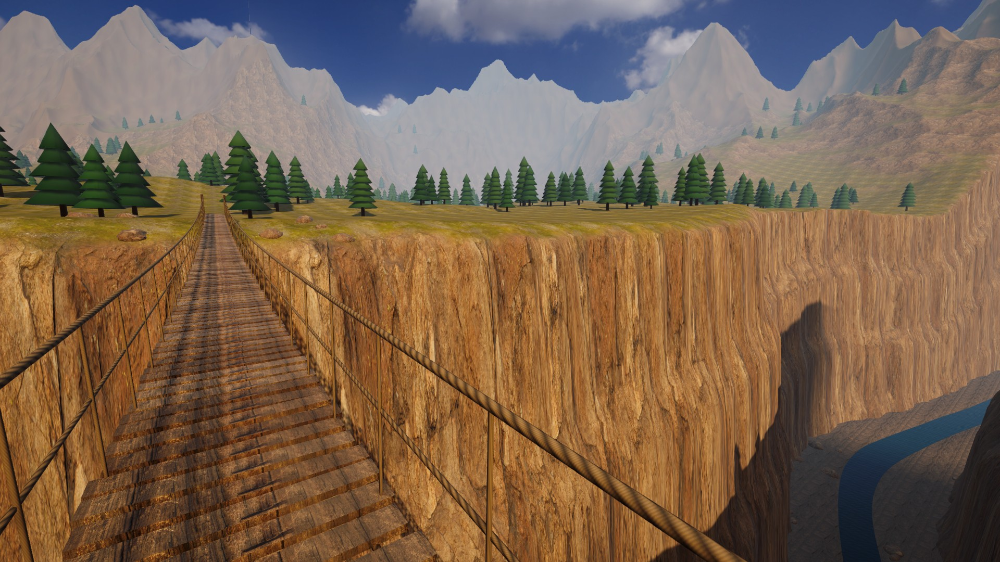
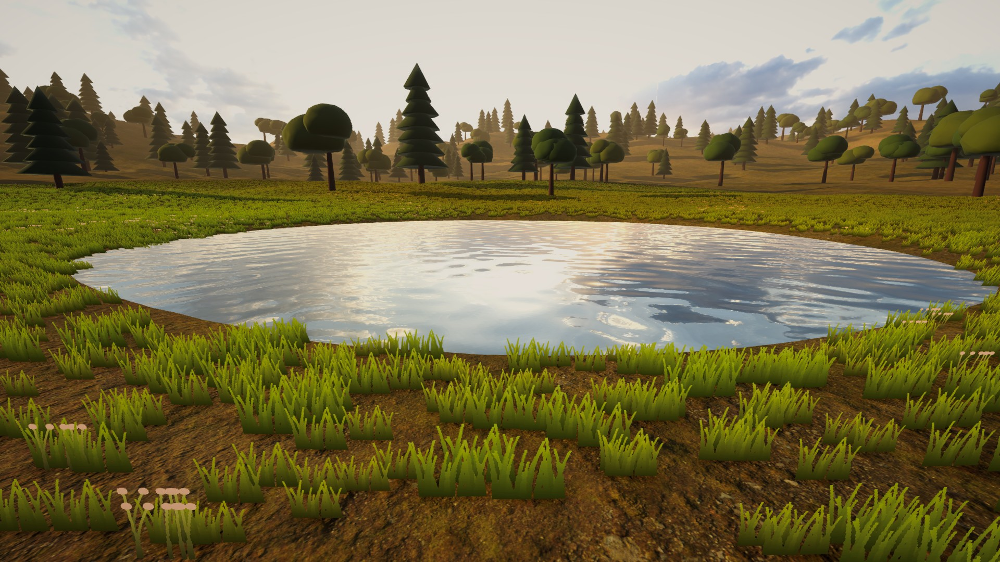
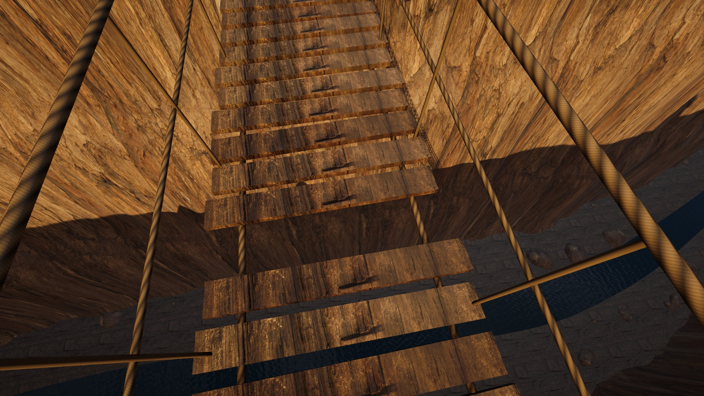
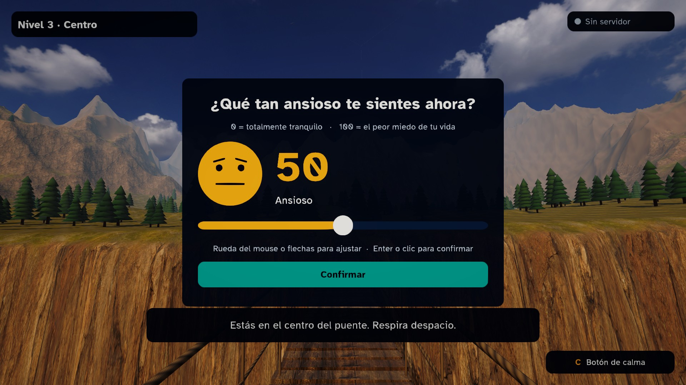
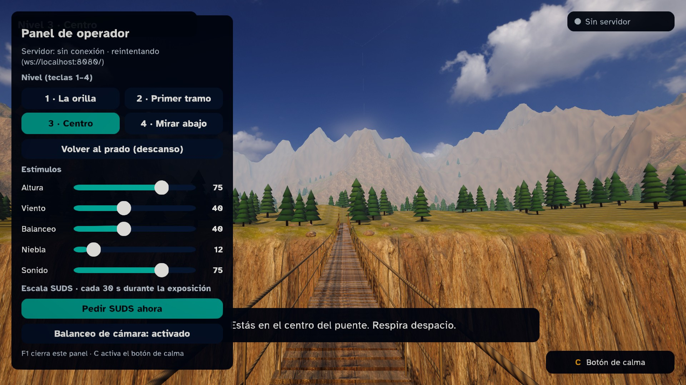

# Acrofobia VR: prototipo de desensibilización sistemática

Prototipo académico de la ESPE (*Desarrollo de Software Global Aplicado a la Interculturalidad*) para exponer **gradualmente** a una persona con miedo a las alturas, y avanzar solo cuando su ansiedad baja. La ansiedad se mide con la **escala SUDS** (0 = totalmente tranquilo, 100 = el peor miedo de su vida).

> **Prototipo académico. No es una herramienta clínica validada.**



| Prado (lugar seguro) | Mirar abajo (nivel 4) |
|---|---|
|  |  |
| **Escala SUDS** | **Panel del operador (F1)** |
|  |  |

## Qué incluye

| Pieza | Descripción |
|---|---|
| **App inmersiva** (`unity/AcrofobiaVR`) | Unity 6 (URP). Un puente colgante sobre un cañón de ~200 m con 4 niveles, 5 estímulos ajustables en vivo, escala SUDS, botón de calma, prado de descanso y tutorial. Por ahora se usa con mouse y teclado; está preparada para pasar a Meta Quest 3. |
| **Consola del terapeuta** (`server/public`) | Web, sin framework: niveles, estímulos, botón de calma, gráfica SUDS en vivo con el nivel de fondo, sugerencias, registro de eventos, resumen y exportación CSV. |
| **Servidor** (`server`) | Node.js + Express + WebSockets + SQLite. Une ambas partes y guarda las sesiones. |

Todo lo de Unity (escenas, terreno, puente, materiales, UI y configuración) **se genera por código**: no hay pasos manuales en el editor.

## Requisitos

- **Unity 6000.6.0f1** (Unity Hub) con *Windows Build Support*
- **Node.js 20 o superior** (probado con 24.16). Para `npm run fake-vr` se necesita Node 22+.
- Windows 10/11 (probado en Windows 11)

## Instalación

```bash
cd server
npm install
```

El proyecto de Unity se abre desde Unity Hub con **Add → Add project from disk → `unity/AcrofobiaVR`**. Las escenas ya están generadas. Para regenerarlas, usa el menú **Acrofobia > Construir escenas** o, con el editor **cerrado**:

```powershell
./tools/unity-batch.ps1
```

## Ejecutar

### 1. Servidor y consola

```bash
cd server
npm start
```

Abre **http://localhost:8080**. En la terminal aparecen también las direcciones para conectarse desde otra PC de la red.

### 2. App de Unity

- **En el editor:** abre `Assets/Scenes/Boot.unity` y pulsa Play.
- **Build de Windows:** `./tools/unity-batch.ps1 -Method Acrofobia.Editor.Build.PlayerBuilder.BuildWindowsBatch` genera `builds/Windows/AcrofobiaVR.exe` (o usa el menú **Acrofobia > Build de Windows**).
- **Servidor en otra PC:** `AcrofobiaVR.exe -server ws://192.168.1.20:8080`.

La app funciona **igual sin servidor**: el panel **F1** controla todo localmente. Cuando el servidor vuelve, se reconecta sola y envía las respuestas SUDS que quedaron pendientes.

### 3. Probar la consola sin Unity

```bash
cd server
npm run fake-vr
```

`tools/fake-vr.js` simula la app: acepta todos los comandos y responde SUDS que bajan con el tiempo, como en una habituación real.

## Controles (paciente)

| Entrada | Acción |
|---|---|
| Mouse | Mirar |
| W / S | Avanzar o retroceder, despacio, solo dentro de la zona del nivel |
| **C** | **Botón de calma**: vuelve al prado desde cualquier estado |
| Rueda / flechas · clic / Enter | Ajustar y confirmar la escala SUDS |
| Esc | Pausa: balanceo de cámara, sensibilidad y salir |
| **F1** | Panel del operador: niveles (teclas 1–4 con el panel abierto), estímulos, pedir SUDS y estado de la conexión |

## Guion de la demo (3 minutos)

| Tiempo | Qué hacer | Qué mostrar |
|---|---|---|
| 0:00 | `npm start`, abrir la consola y luego la app. | Insignia **"VR conectada"**. En la app, el aviso académico en el prado. |
| 0:20 | En la app, pulsar Enter para recorrer el tutorial y practicar la escala SUDS. | Panel SUDS con número, palabra, color y carita. |
| 0:45 | En la consola, escribir el alias "Demo" y pulsar **Iniciar sesión**. Luego, **Nivel 1**. | Fundido al cañón: el paciente está en tierra firme, mirando el puente. |
| 1:00 | **Nivel 2** y luego **Nivel 3**. Subir **Viento** y **Balanceo**. | El puente se mece y el viento sopla; el cambio es suave y tarda menos de 1 s en empezar. |
| 1:30 | Esperar la pregunta automática (30 s) o pulsar **Pedir SUDS ahora**. Responder en la app. | El punto aparece en la gráfica, con el nivel de fondo. |
| 2:00 | **Nivel 4** y mirar hacia abajo. | Viento y balanceo fuertes, y la **tabla faltante** bajo los pies. Si el SUDS es ≥ 70, la consola sugiere bajar la intensidad. |
| 2:20 | Pulsar **C** en la app (o **Botón de calma** en la consola). | Fundido al prado, mensaje "Estás a salvo" y guía de respiración. |
| 2:40 | Cerrar el servidor (Ctrl+C) y mostrar que la app sigue funcionando con **F1**. Volver a ejecutar `npm start`. | La app se reconecta sola. |
| 2:50 | **Terminar sesión** y luego **Exportar CSV**. | Resumen por nivel y archivo CSV con SUDS y eventos. |

## Pruebas

```powershell
cd server; npm test                                   # servidor: 4 pruebas de integración
./tools/unity-batch.ps1 -Tests                        # Unity EditMode: 28 pruebas
./tools/unity-batch.ps1 -Tests -Platform PlayMode     # Unity PlayMode: 5 pruebas del flujo completo
```

Las capturas de `docs/screenshots` también se generan por código: `Acrofobia > Capturas de referencia` para los entornos y la prueba explícita `UiCaptureTests` para la UI en ejecución.

## Documentación

- [`docs/ARCHITECTURE.md`](docs/ARCHITECTURE.md): arquitectura, diagramas y cómo pasar a VR.
- [`docs/PROTOCOL.md`](docs/PROTOCOL.md): protocolo de mensajes y API.
- [`docs/DECISIONS.md`](docs/DECISIONS.md): decisiones tomadas y sus motivos.
- [`docs/CREDITS.md`](docs/CREDITS.md): recursos externos y sus licencias (todos CC0 u OFL).

## Privacidad

La consola pide solo un **alias** del paciente: nunca escribas el nombre real. Los datos quedan en `server/data/acrofobia.db`, que Git ignora.

## Referencias

- Rothbaum, B. O., Hodges, L. F., Kooper, R., Opdyke, D., Williford, J. S., & North, M. (1995). Effectiveness of computer-generated (virtual reality) graded exposure in the treatment of acrophobia. *American Journal of Psychiatry, 152*(4), 626–628.
- Wolpe, J. (1969). *The Practice of Behavior Therapy*. Pergamon Press (escala SUDS).
