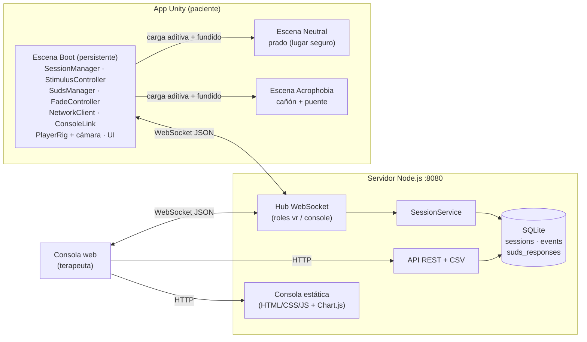
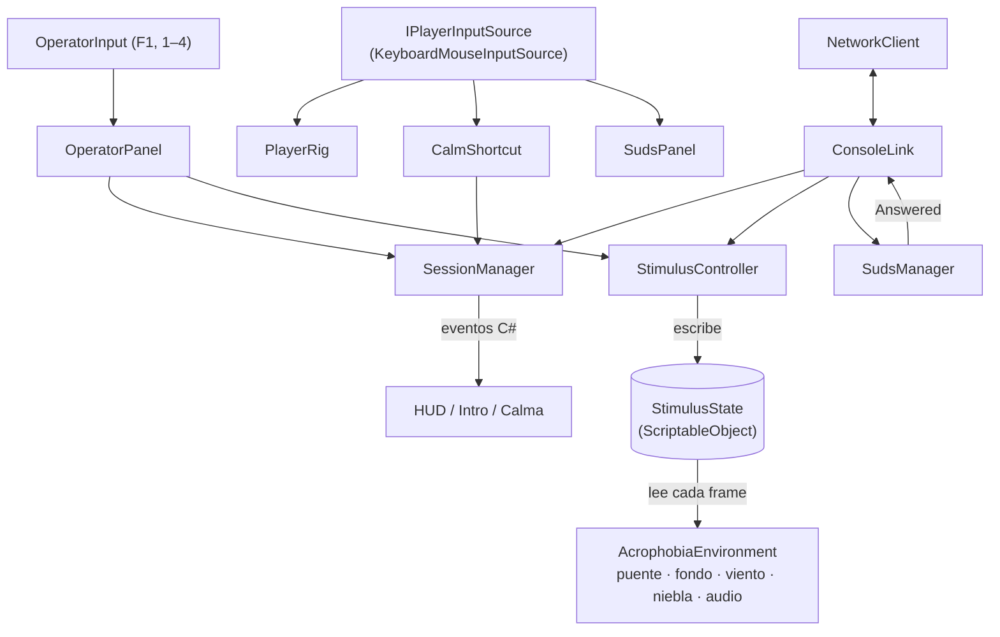

# Arquitectura

## Vista general

## Unity

### Escenas

- **Boot** nunca se descarga. Contiene la raíz `App` (`DontDestroyOnLoad`), con los managers, el jugador y la cámara, la UI y el `EventSystem`.
- **Neutral** y **Acrophobia** son escenas de entorno. No tienen cámara ni referencias a Boot. Cada una tiene en su raíz un `EnvironmentRoot`, que expone un `IWalkPath` y `ApplyLevel(LevelDefinition)`.
- `SessionManager` funde a negro, descarga el entorno anterior, carga el nuevo de forma aditiva y asíncrona, lo marca como escena activa (así aplica su cielo, niebla y luz ambiental), busca su `EnvironmentRoot` y coloca el rig sobre el camino.
- En el editor, si das Play en Neutral o Acrophobia, `StartupOptions` carga primero Boot y luego entra en esa escena.

### Comunicación entre sistemas

- **Eventos C#** para avisos dentro de Boot: `StateChanged`, `CalmTriggered`, `LevelEntered`, `Answered` y `TargetsChanged`.
- **Canal en ScriptableObject** (`StimulusState`) para cruzar escenas: el controlador de Boot escribe y los entornos leen. Ninguna escena guarda una referencia a un manager.
- **`ConsoleLink`** es el único que conoce el protocolo. Traduce mensajes a llamadas (`GoToLevel`, `SetTarget`, `TriggerCalm`, `Request`) y eventos a mensajes. Los managers no saben que existe la red.

### Datos

| Asset | Contenido |
|---|---|
| `Data/Levels/Level1..4` (`LevelDefinition`) | Nombre, descripción, indicación, rango permitido sobre el camino, vista inicial, tabla faltante y estímulos por defecto. |
| `Data/Levels/LevelCatalog` | Lista ordenada de niveles. Agregar un nivel es agregar un asset aquí. |
| `Data/StimulusSettings` | Curvas y rangos que convierten 0–100 en metros, Hz, densidad de niebla, partículas por segundo y volumen. |
| `Data/SudsSettings` | Intervalo (30 s en la demo), valor inicial y paso. |
| `Data/NetworkSettings` | URL del servidor (se sobrescribe con `-server`) e intervalo de los reportes. |
| `Data/UiTheme` | Fuentes y paleta. |

### Entrada y el paso a VR

`IPlayerInputSource` abstrae el dispositivo del paciente: mirar, moverse, calma, confirmar, ajustar un valor y pausa. Para pasar a Meta Quest 3:

1. Implementar `XrInputSource : IPlayerInputSource` con `DrivesHeadPose = true` (la cámara la mueve el visor, no el mouse).
2. Reemplazar el `Camera Pivot` del rig por un XR Origin. `PlayerRig` sigue moviendo la raíz sobre el `IWalkPath` y ya no aplica el *yaw/pitch* del mouse cuando `DrivesHeadPose` es verdadero.
3. Pasar el Canvas a *World Space* frente al usuario y el fundido a un quad pegado a la cámara (las capas de pantalla no se ven en VR).

`OperatorInput` (F1 y 1–4) queda en el teclado del operador.

### Entorno procedural

- **Cañón:** heightmap de 2049² generado en el editor (`CanyonLayout`), con garganta, estratos, borde redondeado y montañas, más una capa de texturas según la pendiente y pinos.
- **Fondo móvil** (`CanyonFloor`): una franja que sigue el cauce, con río y rocas. El estímulo de altura la mueve en Y, de 10 a 150 m bajo el puente.
- **Puente** (`SuspensionBridge` + `BridgeShape`): catenaria resuelta por bisección; el balanceo es un seno más ruido aplicado como desplazamiento lateral y giro. Las tablas, cuerdas (`RopeTube`) y tirantes se reposicionan cada frame con la misma función que usa el jugador para caminar, así que nunca se desincronizan.
- **Audio:** viento y pájaros sintetizados en `OnAudioFilterRead`, sin clips.

## Servidor

| Módulo | Responsabilidad |
|---|---|
| `protocol.js` | Tipos, validación y normalización de payloads. |
| `hub.js` | Conexiones, roles, enrutamiento, heartbeat y reemplazo de la VR. |
| `sessionService.js` | Ciclo de vida de la sesión (solo una activa; se retoma tras reiniciar), qué se persiste y el resumen. |
| `db/` | Esquema SQLite y repositorio con *prepared statements*. |
| `api.js`, `csv.js` | API REST y exportación. |

La persistencia de `state.update` se filtra: solo se guarda cuando cambian la escena, el nivel, los objetivos o el intervalo, para no escribir una fila cada 3 s.

## Pruebas

| Suite | Qué cubre | Cómo ejecutarla |
|---|---|---|
| Unity EditMode (28) | Catenaria, mezclador de estímulos, escala SUDS, protocolo JSON, URL por línea de comandos y cola offline. | `./tools/unity-batch.ps1 -Tests` |
| Unity PlayMode (5) | Boot → Neutral, niveles y tabla faltante, calma con el panel abierto, interpolación y respuesta SUDS. | `./tools/unity-batch.ps1 -Tests -Platform PlayMode` |
| Servidor (4) | Validación, flujo completo con confirmación y deduplicación, CSV, `vr_offline` y reemplazo de VR. | `cd server && npm test` |
