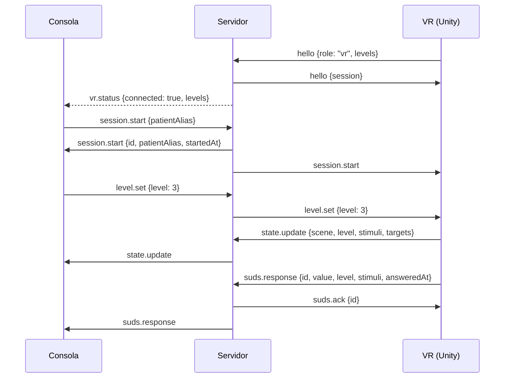

# Protocolo de mensajes

La app de Unity (rol `vr`) y la consola web (rol `console`) se comunican con el servidor por **WebSocket**, en el mismo puerto que la consola (8080 por defecto). Cada mensaje es un objeto JSON:

```json
{ "type": "level.set", "payload": { "level": 3 }, "ts": 1763330401690 }
```

| Campo | Tipo | Descripción |
|---|---|---|
| `type` | string | Tipo de mensaje (tabla de abajo). |
| `payload` | object | Datos del mensaje. Puede ser `{}`. |
| `ts` | number | Marca de tiempo del emisor, en milisegundos desde epoch (UTC). |

## Flujo general



1. Al conectarse, todo cliente **debe** enviar `hello` con su rol en menos de 5 segundos; si no, el servidor cierra la conexión (código 4001).
2. Solo hay una VR a la vez. Si se conecta otra, la anterior se cierra con el código **4000** (`replaced`) y espera 15 s antes de reintentar, para que dos instancias no se peleen el lugar.
3. Los comandos de la consola se validan, se guardan como eventos y se reenvían a la VR. Si la VR no está conectada, la consola recibe un `error` con código `vr_offline`.
4. El servidor hace *ping* cada 15 s y cierra las conexiones que no responden.

## Mensajes

### Conexión

| Tipo | Dirección | Payload |
|---|---|---|
| `hello` | VR → servidor | `{ role: "vr", client, version, levels: [{ number, name, description }] }` |
| `hello` | consola → servidor | `{ role: "console" }` |
| `hello` | servidor → VR | `{ role: "vr", session }` (`session` es `null` si no hay ninguna activa) |
| `hello` | servidor → consola | `{ role: "console", vr, session, suds, vrState }`: estado completo, para que la consola se recupere si se recarga la página |
| `vr.status` | servidor → consola | `{ connected, client?, version?, levels? }` |
| `error` | servidor → cliente | `{ code, message }` |

### Sesión

| Tipo | Dirección | Payload |
|---|---|---|
| `session.start` | consola → servidor | `{ patientAlias }`: solo un alias, de 40 caracteres como máximo |
| `session.start` | servidor → todos | `{ id, patientAlias, startedAt, endedAt: null }` |
| `session.end` | consola → servidor | `{}` |
| `session.end` | servidor → consola | `{ session, summary }`, con `summary`: duración, cantidad, promedio, pico, primera y última respuesta, y datos `byLevel` |
| `session.end` | servidor → VR | `{ id }` |

Si el servidor se reinicia con una sesión abierta, la retoma al arrancar, así que las respuestas SUDS que lleguen después quedan en la misma sesión.

### Control de la exposición (consola → servidor → VR)

| Tipo | Payload | Efecto en la VR |
|---|---|---|
| `level.set` | `{ level: 1..4 }` | Fundido, carga del cañón si hace falta, posición del nivel y estímulos por defecto. |
| `stimulus.set` | `{ stimulus: "height" \| "wind" \| "sway" \| "fog" \| "sound", value: 0..100 }` | Nuevo objetivo; el valor real se interpola en ~2 s. |
| `calm.trigger` | `{ source: "console" }` | Fundido al prado, estímulos al mínimo y mensaje de calma. |
| `suds.request` | `{ source: "console" }` | Abre el panel SUDS en cuanto sea posible. |
| `suds.config` | `{ intervalSeconds: 10..600 }` | Cambia el intervalo de las preguntas automáticas. |

La consola limita el envío de los deslizadores a uno cada 120 ms por estímulo. El servidor recorta los valores a sus rangos.

### Reportes de la VR (VR → servidor → consola)

| Tipo | Payload |
|---|---|
| `state.update` | `{ scene: "neutral" \| "acrophobia", level: 0..4, levelName, stimuli, targets, sudsIntervalSeconds, transitioning, sudsOpen }`. Se envía cada 3 s y, como máximo, 0,25 s después de cualquier cambio. `stimuli` son los valores interpolados actuales y `targets`, los objetivos. |
| `suds.response` | `{ id, value: 0..100, level, scene, trigger: "auto" \| "console" \| "local", answeredAt, queued, stimuli }` |
| `calm.trigger` | `{ source: "patient" }`, cuando el paciente pulsa C. |

### Entrega confiable de SUDS

- Unity guarda cada respuesta en una cola persistente (`suds_outbox.json` en `Application.persistentDataPath`) **antes** de enviarla.
- El servidor responde `suds.ack { id }` y solo entonces Unity la borra de la cola.
- Al reconectarse, Unity reenvía todo lo pendiente. El servidor ignora los `id` repetidos (`INSERT OR IGNORE`), así que reenviar nunca duplica datos.
- `queued: true` indica que la respuesta no salió en el momento; la consola la marca como "enviada al reconectar". `answeredAt` conserva la hora real de la respuesta.

## API HTTP

| Ruta | Respuesta |
|---|---|
| `GET /api/sessions` | Lista de sesiones con `sudsCount`, `sudsAverage` y `maxLevel`. |
| `GET /api/sessions/:id` | `{ session, summary, suds, events }` |
| `GET /api/sessions/:id/export.csv` | CSV (separador `;`, UTF-8 con BOM, para Excel en español) con SUDS y eventos en una sola línea de tiempo. |
